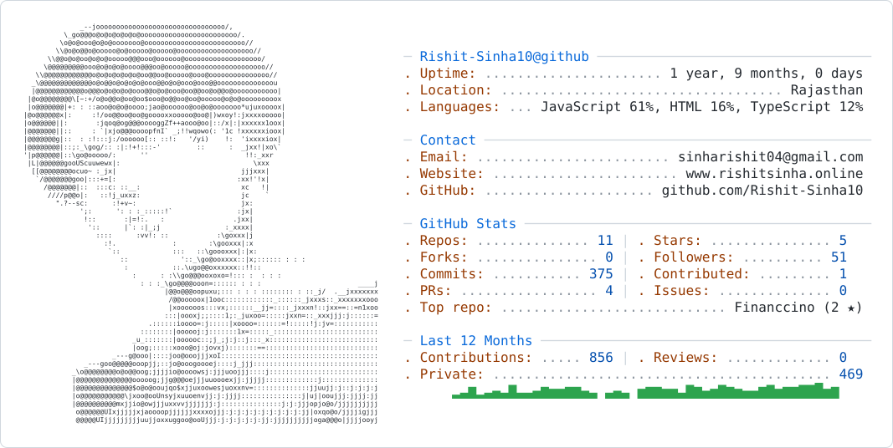

# Rishit-Sinha10

GitHub profile repository for Rishit-Sinha10 featuring a theme-aware ASCII profile card.

<picture>
  <source media="(prefers-color-scheme: dark)" srcset="assets/dark_mode.svg">
  <source media="(prefers-color-scheme: light)" srcset="assets/light_mode.svg">
  
</picture>

## Features

- **Theme-Aware Display**: Renders `assets/dark_mode.svg` or `assets/light_mode.svg` based on the viewer's system color scheme preference.
- **Workflow Automation**: Contains GitHub Actions workflows defined in `.github/workflows/gitascii.yml` and `.github/workflows/main.yml`.

## Project Structure

```
├── .github/
│   └── workflows/
│       ├── gitascii.yml
│       └── main.yml
├── assets/
│   ├── dark_mode.svg
│   └── light_mode.svg
└── README.md
```